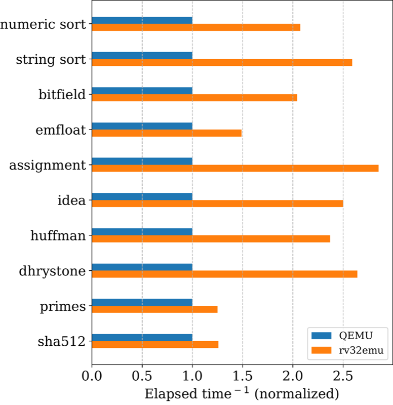

# Benchmarks

The benchmarks are classified based on their characteristics and cover
various aspects of system performance. Most are derived from the
industry-standard BYTEmark (nbench) suite, supplemented by cryptographic
and system benchmarks:

| Benchmark     | Description |
| ------------- | ----------- |
| numeric sort  | Focuses on sorting integer arrays using various algorithms |
| string sort   | Evaluates string sorting capabilities |
| bitfield      | Tests bitwise operations and integer arithmetic on data words |
| emfloat       | Focuses on emulating floating-point calculations using integer arithmetic |
| assignment    | Tests solving resource allocation problems (e.g., assignment algorithm) |
| idea          | Assesses encryption and decryption using the International Data Encryption Algorithm (IDEA) |
| huffman       | Measures performance in data compression using Huffman coding |
| dhrystone     | Assesses general integer performance with a mix of string processing and control operations |
| primes        | Measures efficiency in computing prime numbers using algorithms like the Sieve of Eratosthenes |
| sha512        | Tests cryptographic hash computations |

These benchmarks were performed by rv32emu (with tiered JIT enabled) and
QEMU v9.0.0 on an Intel Core i7-11700 CPU running at 2.5 GHz with Ubuntu
Linux 22.04.1 LTS. The toolchain used was GCC v14.2.0 with RV32IM
extensions.

The figure below illustrates the speedup (normalized reciprocal of average
elapsed time over 200 iterations) of rv32emu with tiered JIT compilation
compared to QEMU. Higher values indicate better performance.



Performance summary:
- rv32emu with tiered JIT compilation outperforms QEMU v9.0.0 across all benchmarks
- Significant performance gains in compute-intensive workloads (primes, sha512, emfloat)
- Strong performance in optimization and cryptography benchmarks (assignment, idea, huffman)
- Consistent advantages in sorting operations (numeric sort, string sort)
- The tiered JIT approach effectively balances compilation overhead with code optimization quality

## Interpreter comparison

`tests/interpreter_bench.py` measures the workloads listed above using
externally timed process lifetimes. It compares interpreter-only rv32emu with
libriscv while explicitly disabling libriscv translation:

```sh
python3 tests/interpreter_bench.py \
    --libriscv <path-to-compatible-libriscv-rv32-runner> \
    --libriscv-build-flags '-DRISCV_BRK_MEMORY_SIZE=33554432' \
    --runs 3 --warmup 1 --json build/interpreter-bench.json
```

Use `--libriscv-args` when a compatible runner needs runtime options. For
example, the ARM64 32 MiB runner is invoked with `--libriscv-args '-m 32'`.

By default the runner skips `bitfield` and `idea`, whose single interpreter runs
take many minutes. Pass `--workloads all` to include them, or a comma-separated
list of workload names to select a subset.

The runner verifies an interpreter-only effective configuration, interleaves
the two engines, retains raw samples and build provenance in the JSON report,
and returns failure unless rv32emu wins every workload by the configured
statistical margin (2% by default).

The libriscv runner must support these static newlib guests and accept `-n` to
disable translation. The runner preflight compares normalized guest output and
refuses to time a workload if either emulator fails or produces a different
result. `primes` needs more than libriscv's stock 16 MiB `brk` cap, so build
the RV32 newlib runner with `-DRISCV_BRK_MEMORY_SIZE=33554432`.

## Dhrystone and CoreMark

`tests/bench.py` runs the prebuilt Dhrystone and CoreMark guests, which
`make artifact` fetches. It measures whatever `build/rv32emu` was built as;
`--emu` selects another binary, and `--label` names the execution mode so that
results from different modes stay apart:

```sh
make interpreter_defconfig && make && python3 tests/bench.py
make defconfig && make && python3 tests/bench.py --label T1C
make jit_defconfig && make && python3 tests/bench.py --label T2C
```

CoreMark results are rejected when the guest reports a checksum mismatch, so a
miscompiling JIT cannot post a score.

Reference results (mean of three runs; the eMAG interpreter Dhrystone ran once,
because one run exceeds five minutes):

| Host | Mode | Dhrystone (DMIPS) | CoreMark (iterations/s) |
| --- | --- | ---: | ---: |
| AMD Threadripper 2990WX, GCC 14.2 | Interpreter | 2,533 | 1,835 |
| | T1C | 16,269 | 7,081 |
| | T2C | 33,365 | 13,272 |
| Ampere eMAG, Clang 18.1 | Interpreter | 792 | 703 |
| | T1C | 7,052 | 4,640 |
| | T2C | 10,273 | 6,164 |

### Comparing two builds

Scores from different machines, or from one shared machine at different times,
differ by far more than most changes do. To judge a change, build both
revisions in the same mode and let `--baseline` measure them side by side:

```sh
git worktree add ../rv32emu-base origin/master
make -C ../rv32emu-base jit_defconfig && make -C ../rv32emu-base ENABLE_T2C=0
python3 tests/bench.py --label T1C --runs 6 --parallel 2 \
    --baseline ../rv32emu-base/build/rv32emu --emu build/rv32emu
```

Each pair runs the baseline and the candidate at the same time, so both see
the same interference ("duet benchmarking"), and alternates which starts
first. The report gives the geometric mean of the per-pair ratios with a 95%
confidence interval over all pairs. A change is reported as faster or slower
only when its interval excludes zero and it exceeds `--threshold` (2% by
default). A pair in which only one member was disturbed widens the interval,
so a noisy host yields "no significant change" rather than a false verdict;
add pairs with `--runs` to recover precision. `--parallel 2` runs the
Dhrystone and CoreMark pairs at the same time, which needs four idle CPUs.
`--schedule interleaved` runs the two members of a pair one after the other
instead, which suits hosts with too few idle CPUs for two emulators.
`--baseline-name` and `--candidate-name` replace the column headings, for
example with the revisions measured.

Two host effects are worth knowing when reading results:

- Address space layout randomization moves the emulator and its JIT buffer.
  On an x86-64 host, T1C Dhrystone ranged from 15,600 to 17,300 DMIPS across
  runs with randomization and within 0.8% without it. The runner leaves it
  enabled, because one fixed layout can favor one binary over another, and
  relies on repeated pairs instead.
- An identical-binary (A/A) comparison is a quick check that a host is quiet
  enough: it should report no significant change.

## System emulation

In system mode the guest's clock derives from the emulated cycle count, so the
scores a guest prints for itself (DMIPS, iterations per second) come out the
same under every engine. `tests/system-bench.sh` instead boots the prebuilt
Linux image and times, in host wall-clock milliseconds, the boot to the login
prompt and four workloads in the guest: Dhrystone and CoreMark from the root
file system, 300 runs of `/bin/true` from a shell loop, which exercises process
creation and the page-table flushes that come with it, and a `dd | gzip |
md5sum` pipeline:

```sh
make system_defconfig && make && make artifact    # T1C
tests/system-bench.sh build/rv32emu 3
```

`system_interpreter_defconfig` and `system_jit_defconfig` build the other two
modes.

Reference results in milliseconds, pinned to two CPUs (mean of three runs,
alternating between modes; the eMAG host has no T2C build):

| Host | Mode | Boot | Dhrystone | CoreMark | fork+exec | gzip |
| --- | --- | ---: | ---: | ---: | ---: | ---: |
| AMD Threadripper 2990WX, GCC 14.2 | Interpreter | 7,330 | 69,758 | 20,663 | 10,974 | 6,778 |
| | T1C | 3,833 | 20,244 | 6,140 | 10,324 | 1,932 |
| | T2C | 4,074 | 8,117 | 4,779 | 10,397 | 2,089 |
| Ampere eMAG, Clang 18.1 | Interpreter | 15,141 | 110,976 | 37,339 | 20,628 | 11,828 |
| | T1C | 9,179 | 49,101 | 10,513 | 20,402 | 4,154 |

Process creation is the hard case for a JIT under a guest OS. Compiled code
belongs to one address space, and Linux issues a full `SFENCE.VMA` several
times in the life of each process, so short-lived processes discard their
blocks, kernel code included, before compiling pays off, and much of the code
runs interpreted. Both tiers still come out slightly ahead of the interpreter
there: in system builds a looping block compiles after 64 dispatches
(`LOOP_THRESHOLD`), the interpreter profiles one chained branch in 32
(`PROBE_INTERVAL`), the cache keeps 4096 blocks (`BLOCK_CACHE_CAPACITY_BITS`),
and neither evicting a block, flushing a page without compiled code, nor
flushing an address space scans the whole cache or the JIT's tables. Keying
compiled code by physical page, so that a mapping flush keeps code whose page
did not change, would turn this case into a clear gain.

## Continuous benchmarking

`.github/workflows/benchmark.yml` measures the interpreter, T1C, and T2C.

For a pull request, each mode is built twice on one runner: from the pull
request merged into master, and from the master commit it merges into. The
comparison above then runs on that runner, and its table appears in the job
summary, with the master commit as "Previous" and the pull request head as
"Current". The tables are posted as a single pull request comment, updated on
each push: by the workflow itself for a pull request from this repository, and
by `.github/workflows/benchmark-comment.yml` for one from a fork, whose run
cannot be granted permission to comment. Pull request results are never
recorded on the dashboard.

Each push to master records all three modes on the
[dashboard](https://sysprog21.github.io/rv32emu-bench/), built with
[github-action-benchmark](https://github.com/benchmark-action/github-action-benchmark).
The interpreter keeps the original `Dhrystone` and `CoreMark` series; the JIT
modes appear as `Dhrystone (T1C)`, `CoreMark (T2C)`, and so on. Each entry
names the runner CPU. The dashboard shows long-term trends. It cannot show
small changes, because GitHub assigns runners of different speeds. Before this
workflow compared each pull request against its own base, one master commit had
dashboard entries of 2,157 and 3,950 DMIPS.

Changes to `src/`, `configs/`, `mk/`, the `Makefile`, `tools/detect-env.py`,
`tests/bench.py`, or the workflow itself trigger the benchmark (see
`.github/workflows/benchmark.yml` for the authoritative list).

## Signed division fast path

The interpreter and constant folder share the signed DIV/REM helpers in
`src/common.h`. The unsigned test `(divisor + 1U) > 1U` excludes both zero and
-1 from the host divide. Unsigned negation supplies the quotient for -1,
including `INT32_MIN`; its remainder is always zero. This preserves RISC-V
overflow and division-by-zero behavior without a separate dividend overflow
check.

`tests/signed-div-bench.S` measures eight DIV/REM pairs per iteration with
operands loaded from memory. Build each divisor variant as follows:

```sh
riscv64-linux-gnu-gcc -march=rv32im -mabi=ilp32 -nostdlib -static \
    -DDIVISOR=-1 tests/signed-div-bench.S -o build/signed-div-bench
```

Use an interpreter-only build and repeat with `-DDIVISOR=7` and
`-DDIVISOR=0`. Compare before/after binaries with identical configuration,
affinity, and compiler flags; alternate their execution order and discard
one warmup per binary. These are synthetic throughput measurements, not
application speedups.

On an AMD Ryzen Threadripper 2990WX (x86-64), GCC 14.2.0, `-O2` with LTO,
default configuration changed to interpreter-only, seven measured runs
of ten million iterations gave these median process times:

| Divisor | Before (s) | After (s) | Time reduction |
| --- | ---: | ---: | ---: |
| 7 | 1.1146 | 1.1102 | 0.4% |
| -1 | 1.6123 | 0.7988 | 50.5% |
| 0 | 0.3975 | 0.4357 | -9.6% |

The ordinary-divisor difference is too small to claim a speedup. Division
by -1 avoids host division entirely; the zero-only workload regresses
because the shared exceptional-divisor path adds work compared with the
previous direct zero check.

## T1C native arithmetic and boolean comparisons

The x86-64 tier-1 emitter applies two changes:

- Guard exceptional divisors before native signed division, and use
  widening products for RV32 multiply-high operations.
- Lower boolean comparison results directly to host instructions.

DIV/REM now use 32-bit IDIV with a cold path for zero and -1. This removes
PUSHFQ/POPFQ, dividend saves, and redundant overflow fixups. The exceptional
path uses unsigned-width negation for `INT32_MIN / -1`, so it cannot trap.
DIVU/REMU similarly bypass native division for zero. Unrelated guest values
cached in RAX/RDX are preserved, and every division result is zero-extended
before another guest instruction can use it as a memory address.

MULH/MULHSU/MULHU use two-operand 64-bit IMUL on appropriately extended RV32
operands, followed by a logical shift. Their full product's low 64 bits are
identical regardless of the host instruction's signedness; the operand
extensions determine the required high word. This avoids borrowing RAX/RDX.
SLT/SLTU/SLTI/SLTIU use SETcc and MOVZX, including an explicit REX prefix for
low-byte registers and a full 32-bit result. Writes to x0 are discarded.
AArch64 retains its existing multiply/divide and comparison lowering.

### Measurements

These compare the immediate pre-T1C-change build with the candidate, using
GCC 14.2.0, `-O2`, LTO, and the default configuration with T2C disabled on
an AMD Ryzen Threadripper 2990WX. Unchanged guest ELFs ran alternately on
one CPU. Application and ordinary arithmetic samples use three measured
runs after one warmup per binary on CPU 4. SHA-512 uses three paired runs
on CPU 6 under `perf stat`; all SHA-512 outputs match byte for byte.
Random comparison samples use five measured runs after a warmup on CPU 11.
Times below are medians of host process lifetimes, not guest clock scores.

| Workload | Before (s) | After (s) | Time reduction |
| --- | ---: | ---: | ---: |
| SHA-512 | 25.0245 | 17.3110 | 30.8% |
| CoreMark, 80,000 iterations | 7.6137 | 7.7968 | -2.4% |
| Dhrystone, 500 million passes | 16.2493 | 16.4645 | -1.3% |
| miniz | 11.3009 | 11.1432 | 1.4% |
| edn | 0.0141 | 0.0138 | 1.8% |
| DIV, divisor 7 | 0.2655 | 0.1823 | 31.3% |
| REM, divisor 7 | 0.2604 | 0.1826 | 29.9% |
| MULH | 0.0582 | 0.0200 | 65.7% |
| MULHSU | 0.0604 | 0.0184 | 69.5% |
| MULHU | 0.0580 | 0.0187 | 67.8% |
| SLT, xorshift inputs | 0.0938 | 0.0600 | 36.0% |
| SLTU, xorshift inputs | 0.0942 | 0.0601 | 36.2% |

The SHA-512 change is about 1.45 times the throughput. This is a workload
improvement, not a claim of uniform acceleration: unsigned division times
were unchanged (about 0.2% lower), and predictable comparison inputs gave
-5.1% for SLT and +1.3% for SLTU. CoreMark reports its minimum-duration
warning on these short fixed-iteration runs; these are not official scores.
The short edn run and small application differences do not establish a
reliable speedup. The first SHA-512 hardware-counter pair retired 206.060
billion instructions before and 203.377 billion after, with cycles falling
from 88.022 billion to 60.844 billion. A separate counter run with the
final x0-discard handling reduced SHA-512 branch misses from 986.5 million
to 14.2 million, confirming that eliminating comparison branches is the
main source of its speedup.

The arithmetic microbenchmarks execute eight operations per iteration for
three million iterations. Reproduce an ordinary or random-input variant:

```sh
riscv64-linux-gnu-gcc -march=rv32im -mabi=ilp32 -nostdlib -static -fno-pie \
    -DOP=div tests/jit-arith-bench.S -o build/jit-arith-bench
riscv64-linux-gnu-gcc -march=rv32im -mabi=ilp32 -nostdlib -static -fno-pie \
    -DOP=sltu -DRANDOM_INPUT -DDIVISOR=0x40000000 \
    tests/jit-arith-bench.S -o build/jit-compare-bench
```

Use identical T1C-only emulator configurations, pin both revisions to the
same idle core, alternate their order, and retain individual samples.

### Compatibility checks

`jit-muldiv.S` covers signed and unsigned boundary values, zero divisors,
overflow, all multiply-high signedness combinations, destination/source
aliases, x0 writes, and preservation of live operands under register
pressure. `jit-compare.S` checks exact zero/one results, aliases, signed
boundaries, and sign extension of immediate comparisons. Both also pass
with the interpreter. Existing differential tests cover RV32IM and RV32IMC.

The T1C-only and T1C+T2C configurations pass `make check tests` with the installed
RISC-V Linux cross-compiler; its default PIE is disabled for freestanding
assembly checks. Libc-dependent guest checks are unavailable because that
compiler lacks an RV32 libc multilib. The original system-JIT configuration
builds and passes host tests. Linux boots to a shell, runs Dhrystone and
CoreMark without CRC failures, and returns to the shell. The final system
CoreMark smoke run uses 3,000 iterations and reports "Correct operation
validated." An earlier 1,000-iteration run reported its minimum-duration
warning.

The AArch64 cross-build also passes 11 guest regressions under QEMU 8.2.2:
comparison, multiply/divide pressure, signed division, RV32IM/RV32IMC
differential sweeps, multiply, normalization, ALU aliases, register loops,
and ordinary/compressed loop shapes. This check uses a test-only forced
`HAVE_MMAP=0` include and `USER_MEM_SIZE=512` (MiB): QEMU faults internally
on the default demand-paging startup, even for hello. The production memory
backend is unchanged; this validates generated arithmetic, not AArch64's
4 GiB demand-paging integration. Native Windows execution was not tested.


## T1C three-operand register shifts

A subsequent change lowers register shifts with separate destination, value,
and count operands. Keeping these operands separate lets T1C remove the copies
that previously staged every register shift through a fixed temporary and its
destination.

On x86-64, T1C checks CPUID leaf 7's BMI2 bit once per JIT instance. Supported
hosts emit SHLX/SHRX/SARX with 32-bit operands. Other hosts keep the CL-based
lowering; `JIT_DISABLE_BMI2` forces that path for testing. These BMI2 operations
use GPRs and do not require AVX OS state. The Windows fallback saves RCX,
which holds the emulator pointer, before staging the count in CL. AArch64
emits LSLV/LSRV/ASRV directly from the allocated operands. Both hosts mask
counts to five bits and zero-extend the 32-bit result. Writes to x0 are
omitted, with guest cycle accounting retained.

### Shift measurements

The baseline already includes the preceding arithmetic and comparison
changes. On the same AMD Ryzen Threadripper 2990WX, GCC 14.2.0, `-O2`, LTO,
and default T1C-only configuration, five measured runs after one warmup per
binary, alternating order and pinned to CPU 11, gave these median host
process times. Each guest performs eight shifts per iteration for 100
million iterations, with value and count loaded from memory.

| Operation | Before (s) | After (s) | Time reduction |
| --- | ---: | ---: | ---: |
| SLL | 0.1674 | 0.0953 | 43.0% |
| SRL | 0.1690 | 0.0969 | 42.7% |
| SRA | 0.1676 | 0.0966 | 42.4% |

This is about 1.74–1.76 times register-shift throughput. A separate SLL
counter run retired 2.844 billion instructions before versus 1.243 billion
after, consistent with removing two copies per shift. The smaller ten-million
iteration diagnostic showed 25–27% less process time; startup and compilation
have more weight in that shorter run.

The application sample uses CPU 6, three measured runs after a warmup, and
identical guest binaries. Emfloat took 28.2622 versus 27.9633 seconds (1.1%
lower), SHA-512 16.4340 versus 16.4526 seconds (0.1% higher), and CoreMark
7.4002 versus 7.3951 seconds (0.1% lower). These small differences do not
establish an application-wide speedup. SHA-512's output matches exactly.
The installed nbench emfloat guest prints a zero rate, so only its
process time is reported. CoreMark's fixed 80,000-iteration run reports its
minimum-duration warning, without CRC failures.

Reproduce a shift workload with the shared arithmetic benchmark:

```sh
riscv64-linux-gnu-gcc -march=rv32i -mabi=ilp32 -nostdlib -static -fno-pie \
    -DOP=sll -DDIVISOR=17 -DITERATIONS=100000000 \
    tests/jit-arith-bench.S -o build/jit-shift-bench
```

### Shift compatibility checks

`tests/jit-shift.S` compares all three operations with repeated one-bit
immediate shifts, using boundary values and counts including zero, 31, 32,
63, and large unsigned values. It covers destination/source aliases, live
values under register pressure, source preservation, and discarded x0
writes. Existing ALU alias tests also cover identical value/count operands.
The new test passes with the interpreter, native BMI2, and forced legacy
lowering. All 12,288 VEX register-operand encodings across the three forms
were compared with GNU assembler output.

The GCC T1C-only and T1C+T2C builds pass `make check tests`. Thirteen targeted
guest regressions also pass with BMI2 disabled and with Clang 20 (T1C, no
LTO). Eleven regressions pass under an emulated Nehalem CPU without BMI2,
checking actual runtime feature selection. Eleven pass on AArch64 under
QEMU, including shift pressure and RV32IM/RV32IMC differential sweeps. Both
QEMU checks use the test-only non-demand-paged 512 MiB memory configuration
described above. Native Windows execution was not tested.

A separate GCC `no_callee_saved_registers` interpreter experiment failed a
differential test and was removed. The retained change leaves the interpreter
calling convention unchanged.

The original system-JIT configuration was restored and rebuilt; host tests
pass. Linux boots, runs Dhrystone and a 3,000-iteration CoreMark validation
("Correct operation validated."), and returns to the shell. The saved and
restored `.config` files match byte for byte.

## Broad-suite T1C improvements

The next changes are:

- x86 indexed guest-RAM operands select no displacement, a signed byte
  displacement, or a 32-bit displacement. This applies to stores, including
  stores of zero.
- Register caching extends across local control flow. A loop whose entire
  register set does not fit retains its inputs while spilling temporaries.
  Bounded regions retain register maps across calls, jumps, and both conditional
  outcomes.

Spilling loops reserve three scratch registers and commit temporaries at
backedges. Alignment traps before a temporary's first definition therefore
see its previous-iteration value. Fused instruction inputs are computed in
instruction order. Regions are limited to 16 blocks, 128 IR records, 256
original instructions, and six successor levels, with the combined jump
budget checked before emission. Other entries keep the standalone translation.
Each leaf writes back the complete register file. Returns through unchanged,
known links can use direct jumps. The translator remains a separate C function
under LTO so its region plan does not enlarge every recursive successor frame.

Backward liveness within the region can omit an eviction store only when all
paths overwrite that value before a read or observation. Leaves and helpers
observe the complete register file. Architectural alignment guards are also
barriers, including guards inside fused records. This analysis never assumes
execution beyond a region leaf. These register-caching extensions use user mode
without GDB or the Windows ABI. Region cloning is disabled with T2C, whose
promotion counts dispatcher entries.

On x86, a small left shift followed by an addition can use one 32-bit LEA when
the intermediate is overwritten. This includes a fused shift sequence's last
member and preserves arithmetic modulo 2^32. ADD remains where the following
SLTU could reuse its carry flag. Separately, adjacent ADD/SLTU carry tests reuse
that flag when the compared input was not overwritten. Flag forwarding resets
at each block or region-node entry.

Full-register x86 loops can rotate a one-bit mask whose count advances once
per iteration. A runtime guard checks that its invariant source is one; other
values enter an ordinary copy of the loop. Normal exits retain the current
mask, and budget exits undo the advance to the next mask before writeback.
This also supports complemented masks. The transformation requires unguarded
memory accesses, keeps guest cycle costs, and uses the existing loop budget.

### Broad-suite validation

New freestanding regressions cover displacement boundaries, spilling loops
with early alignment traps, division with pinned values, shared callees and
alternate link registers, compressed branches and calls, exact cycle/instret
counts, branch-specific alignment facts, carry boundary/alias cases, scaled
address wraparound and sign extension, and rotating-mask fallback values.
Inputs come from memory where needed so constant propagation cannot remove
the operations under test.

GCC and Clang T1C builds, GCC UBSan, T1C+T2C, and a build without macro-op fusion
or interpreter block chaining pass `make check tests`. Twenty-seven new guest
variants pass under the interpreter reference and AArch64/QEMU. Thirty checks
pass on an emulated Nehalem CPU without BMI2, including register shifts and
RV32IM/RV32IMC differential execution. The QEMU tests use non-demand-paged
512 MiB memory as described above. Guest C regression builds require an RV32
libc multilib, which is unavailable here; freestanding assembly tests run.
The original system configuration was restored and rebuilt, host checks pass,
and Linux boots, runs Dhrystone, and validates a 3,000-iteration CoreMark run.

### Broad-suite measurements

The suite includes all ten workloads above and CoreMark. The baseline is a
clean `9b2f140` build with the same T1C configuration and dependencies as the
candidate. Measurements use GCC 14.2, `-O2`, LTO, and the AMD Threadripper
2990WX. Each workload has three paired process-time samples with alternating
engine order; workload order reverses in the middle round. No samples are
filtered. Four shards run concurrently on CPUs 2, 6, 10, and 14, using separate
L3 caches. Both engines of each workload use the same CPU.

The criterion follows the repository's published benchmark convention: at
least 2% mean time reduction and a paired log-ratio Student's t 95% interval
excluding zero. The earlier 5% screening target was provisional. The table
reports elapsed-time reduction, rather than throughput increase.

The supplied nbench guest prints zero rates, so only external process times
are used. Its outer measurement loops use fixed counts. Separate debugger
control runs verified equal calibration parameters in both builds: one array
of 8,111 elements/bytes for numeric/string sort, 30 bit-operation ranges and a
32,768-word bitfield, 3,000 elements with one loop for emfloat, one assignment
array, 4,000 elements with 100 loops for IDEA, and 5,000 elements with 100 loops
for Huffman. Those debugger runs are not timing samples. CoreMark's supplied
80,000-iteration guest reports its minimum-duration warning; CRC failures are
rejected. Its elapsed times are not official CoreMark scores.

<!-- BROAD_FINAL_RESULTS -->
All eleven workloads meet the criterion. Before/after columns are median
process times; reductions and intervals come from paired log ratios and
therefore need not equal the ratio of those medians.

| Workload | Before (s) | After (s) | Paired time reduction | 95% CI |
| --- | ---: | ---: | ---: | --- |
| coremark | 7.422 | 5.429 | +26.80% | +25.61% to +27.98% |
| dhrystone | 16.665 | 15.002 | +9.68% | +6.91% to +12.38% |
| sha512 | 24.175 | 15.985 | +33.72% | +33.13% to +34.30% |
| primes | 23.392 | 22.461 | +3.96% | +3.56% to +4.36% |
| numeric_sort | 13.854 | 12.470 | +9.95% | +9.51% to +10.38% |
| string_sort | 9.168 | 7.290 | +20.18% | +19.19% to +21.16% |
| emfloat | 28.786 | 25.687 | +10.65% | +9.84% to +11.45% |
| assignment | 46.165 | 43.742 | +5.06% | +4.27% to +5.84% |
| huffman | 26.431 | 19.711 | +25.41% | +24.16% to +26.65% |
| bitfield | 17.388 | 16.303 | +6.99% | +3.19% to +10.64% |
| idea | 56.023 | 35.700 | +36.25% | +35.01% to +37.47% |
<!-- BROAD_FINAL_RESULTS_END -->

Supplementary checks use the same frozen binaries. Miniz has three alternating
pairs on CPU 14: median times are 10.833 s before and 9.670 s after, a paired
10.81% reduction (95% CI 10.21% to 11.41%). Edn uses fifteen alternating pairs
of fifty separate processes per engine, because one process lasts about
14 ms. Its median per-process times are 13.997 ms before and 14.264 ms after:
a 1.50% slowdown (95% CI 1.09% to 1.91% slower). All outputs match. This does
not establish an all-program performance win.

All three additional nbench modes meet the same criterion, using three
alternating pairs on CPUs 2 (Fourier), 6 (neural network), and 10 (LU):

| Workload | Before (s) | After (s) | Paired time reduction | 95% CI |
| --- | ---: | ---: | ---: | --- |
| fourier | 141.360 | 103.620 | 22.72% | 12.17% to 32.01% |
| neural_net | 501.233 | 380.821 | 26.01% | 20.02% to 31.56% |
| lu | 16.790 | 13.018 | 22.29% | 21.92% to 22.66% |

Their debugger controls verified 100 Fourier coefficients and one LU array
in both builds. The neural-network control also matches (one loop), including
hashes of the final weights and iteration/pass/error state. Together, all
fourteen user-mode suite workloads pass the criterion. These additional modes
run from a directory holding an unmodified copy of the bundled `data/NNET.DAT`.

The original system configuration was measured separately against the same
baseline revision, with three alternating pairs on CPU 14 using
`tests/system-bench.sh`. None of its five measurements establishes a reliable
speedup at the stated criterion. Those measurements precede the system TLB
follow-up below.

The original RAM policy is retained; an experimental huge-page hint was
removed. Earlier screens of incremental candidates are diagnostic only and are
not combined with the final samples. The final runner uses a stable workload
index and audits the actual order of every pair, because an earlier runner did
not alternate engine order in even-sized shards.

### System TLB follow-up

The system-mode TLB tags already distinguish exact 4 KiB VPNs, including
entries populated by a 4 MiB superpage walk. Cache the translated 4 KiB
physical slice at population time. Interpreter hits can then combine it with
a fixed 12-bit offset; the x86 T1C probe no longer selects an offset mask on
every hit. The page level, permissions, PTE address, and dirty state remain
available for invalidation, permission checks, and A/D updates. Arm64's
existing superpage offset remains valid because its middle address bits
already match those in the cached slice. T2C keeps its existing superpage
fallback.

The new flat supervisor regression, `tests/system-mmu-cache.S`, checks load
results, colliding VPNs, two nonzero superpage slices, instruction fetch
across a 4 KiB boundary, dirty-bit updates, read-only stores, precise page and
alignment faults, twelve live register values, and the old load destination.
It runs through `make check` in MMIO system configurations with a suitable
RISC-V assembler.

Its load-result oracle exposed an existing interpreter fault: a memory read's
placeholder could overwrite the destination after an inline trap handler had
skipped the load. Integer and floating-point loads now commit their result
only if the access completed. The unchanged baseline fails the strengthened
regression; GCC T1C, the interpreter, and AArch64/QEMU pass with the fix. The
QEMU check uses the memory-mapping workaround described above.

The user-mode tables above precede this system-only follow-up. The separate
Linux comparison uses the original system configuration, GCC 14.2 with LTO,
the same clean baseline revision, and alternating engine order on CPU 2.
All five initial pairs are retained; four fixed additional pairs narrow the
uncertain intervals. No samples are filtered. Median host times and paired
reductions across all nine pairs are:

| Workload | Before (ms) | After (ms) | Paired time reduction | 95% CI |
| --- | ---: | ---: | ---: | --- |
| boot | 3604 | 3505 | 2.20% | 0.48% to 3.88% |
| dhrystone | 17746 | 16779 | 3.76% | 0.03% to 7.36% |
| coremark | 4905 | 4578 | 7.15% | 6.14% to 8.14% |
| fork-exec | 9544 | 9420 | 0.93% | -0.24% to 2.09% |
| gzip-md5 | 1785 | 1707 | 4.09% | 1.91% to 6.21% |

These nine pairs established wins for boot, Dhrystone, CoreMark, and gzip.
Process creation and startup-bound edn required the integrated follow-up below.
The later test-registration change does not alter executable inputs. Earlier
system screens are diagnostic and are not pooled with these samples.

GCC and Clang system builds pass `make check tests`, including the new flat
kernel. The tiered system build and standard UBSan configuration pass too;
UBSan uses the project's alignment-sanitizer exclusion. System ELF-loader
checks cover instruction faults, misaligned page faults, and FENCE.I. Linux
smoke checks under both T1C and tiered JIT validate CoreMark's CRCs, a 16 MiB
zero-data gzip/decompression checksum, 300 successful process launches, and
emulator exit status. The focused AArch64/QEMU kernel check disables SDL,
networking, and zlib and uses non-demand-paged memory. The original system
configuration is restored, and the main executable is rebuilt.

### Instruction fetch and startup follow-up

A further look at repeated fetch/decode work followed. A bounded decoded-prefix
cache regressed Linux process creation and was discarded. The current follow-up
instead separates the cold instruction-fetch miss handler, exposes the ordinary
MMU callback to LTO while preserving replacement callbacks, and folds iTLB
validity and execute permission into an otherwise unused VPN tag bit. Selective
and full invalidation clear that tag.

The flat kernel now remaps an executed page with selective SFENCE.VMA and
requires the new instruction result. It also invalidates from inside a
synchronous trap. This exposed another existing interpreter fault: SFENCE.VMA
left decoded blocks from the old mapping reusable. The interpreter now retires
those blocks through its deferred-clear path, after active trap handlers stop
using their instruction pointers.

Linux shared builds defer SDL_mixer and its codec dependencies until an audio
request. The library remains loaded for callbacks and teardown; global symbol
visibility matches direct linking. Static builds, other platforms, and
installations without the normal shared-library soname retain direct linking.
`SDL2_MIXER_DYNAMIC=n` also selects direct linking. Run
`make -C tests/sound check-mixer` to compare concurrent initialization, sound
playback, MIDI playback, volume changes, and repeated shutdown against a
directly linked mixer using SDL's dummy audio device. An emulated guest using
the existing MUS and sound-effect fixtures also passed both implementations.

The preceding tables describe earlier stages.

The integrated comparison passes the criterion for all 21 measurements. All
initial samples are retained: assignment and miniz use nine pairs after fixed
six-pair extensions; Linux uses nine pairs; other user workloads use three
pairs, except edn with fifteen batches of 50 processes. The neural-network
calibration parameters and computed state match between engines, and all three
timing pairs have matching normalized output. These are paired elapsed-time
reductions against the same clean baseline, with Student-t 95% confidence
intervals.

| Workload | Time reduction | 95% CI |
| --- | ---: | --- |
| coremark | 26.01% | 24.35% to 27.63% |
| dhrystone | 13.07% | 10.63% to 15.44% |
| sha512 | 33.88% | 33.06% to 34.69% |
| primes | 4.99% | 0.38% to 9.38% |
| numeric_sort | 11.21% | 10.19% to 12.22% |
| string_sort | 21.89% | 19.86% to 23.86% |
| emfloat | 10.85% | 5.68% to 15.73% |
| assignment | 5.71% | 4.43% to 6.98% |
| huffman | 24.83% | 23.54% to 26.10% |
| bitfield | 3.87% | 0.45% to 7.17% |
| idea | 36.47% | 32.81% to 39.92% |
| fourier | 20.39% | 16.40% to 24.19% |
| lu | 21.41% | 17.63% to 25.02% |
| miniz | 11.22% | 7.46% to 14.83% |
| edn | 31.07% | 30.11% to 32.03% |
| neural_net | 21.95% | 14.89% to 28.42% |
| Linux boot | 3.81% | 0.65% to 6.87% |
| Linux dhrystone | 5.94% | 4.35% to 7.50% |
| Linux coremark | 8.43% | 5.26% to 11.49% |
| Linux fork-exec | 4.66% | 0.30% to 8.84% |
| Linux gzip-md5 | 8.40% | 4.14% to 12.48% |

The subsequent interpreter-only remap fix retires pending blocks before
execution even when an inline handler skips the interrupted instruction.
The stronger kernel regression remaps an already executed target inside that
handler, then immediately jumps to it. GCC, Clang, UBSan, and AArch64/QEMU
interpreter checks pass. The native matrix also covers user/system T1C and
tiered execution, ELF faults, unfused/unchained operation, and direct mixer
linking. All 58 user guests pass under x86-64/Nehalem emulation; 53 pass under
AArch64/QEMU, with five existing misalignment-test crashes reproduced on the
clean baseline. The ARM checks use the documented non-demand memory workaround
and 256 MiB user RAM to respect the existing malloc fallback limit.

Frozen timed T1C binaries and rebuilt T1C binaries have identical instruction
addresses and operands except assertion/log source-line constants; all other
allocated ELF sections match except the build ID. Test-only non-PIE
flags let the Linux cross compiler assemble symbol-plus-offset regressions.
The original system configuration remains unchanged.

## Resident region registers and interpreter RAM base

Two changes target memory and register traffic:

- Region register caching only pays when values stay in host registers
  between blocks. T1C picked the first register whose value was dead in the
  current block, so a two-block loop such as CoreMark's list
  search spilled and reloaded its pointer every iteration while eight host
  registers sat empty. The allocator now takes an unmapped register first,
  then a dead clean one, then a dead dirty one. That loop shrinks from about
  fourteen host instructions per iteration to seven.
- The user-mode interpreter reached guest RAM through
  `PRIV(rv)->mem->mem_base`, three dependent loads per access, plus one for
  `allow_misalign`. Both now have copies in `riscv_t` next to the registers.

Counting cycles per block instead of per instruction was also tried: an
upper-bound build without the per-instruction increment ran no faster, so the
exact count stays.

Paired runs (GCC 14.2, `-O2`, LTO, user mode, alternating order) gave these
elapsed-time reductions with Student-t 95% intervals:

| Host | Workload | Reduction | 95% CI | Pairs |
| --- | --- | ---: | --- | ---: |
| x86-64, T1C | CoreMark | 16.0% | 14.6% to 17.4% | 5 |
| x86-64, T1C | miniz | 9.1% | 7.3% to 10.9% | 5 |
| x86-64, T1C | primes | 6.2% | 4.2% to 8.1% | 5 |
| x86-64, T1C | sha512, Dhrystone, nqueens | 0.4% to 1.6% | each spans zero | 5 |
| AArch64, T1C | CoreMark | 8.6% | 8.6% to 8.7% | 5 |
| AArch64, T1C | miniz | 10.9% | 10.6% to 11.1% | 5 |
| AArch64, T1C | qsort | 2.7% | 2.5% to 2.8% | 5 |
| AArch64, T1C | Dhrystone | -0.9% | -0.9% to -0.9% | 5 |
| x86-64, interpreter | nqueens | 3.4% | 3.0% to 3.9% | 9 |
| x86-64, interpreter | qsort | 6.2% | 1.5% to 10.7% | 3 |

x86-64 is the AMD Threadripper 2990WX; AArch64 is an Ampere eMAG built with
Clang. Interpreter CoreMark wall time varied too much on the shared host to
resolve; its counters show 2.2% fewer host instructions and 1.1% fewer
cycles. Linux under system T1C (`tests/system-bench.sh`, five pairs) showed no
change outside noise for boot, Dhrystone, CoreMark, fork+exec, or gzip:
region register caching applies only to user mode.

### Fault fixes found in review

- In system builds, a fused LW group, LUI+LW, or LW+ADDI kept executing after
  a member's fault redirected the hart: it overwrote the faulting load's
  destination, ran later members early, and LW+ADDI gated its increment on
  `trap_cnt`, which is already back to zero once the inline handler returns.
  These records now stop at the faulting member, as an unfused sequence
  would. `tests/fused-page-fault.S` fails all four of its cases, including a
  fault on a later member, on the previous build.
- AMOs wrote rd after their read and before their write. When the write
  faulted, as on a copy-on-write page, the retried instruction saw the
  modified rd; with rd equal to rs2, as compilers emit for fetch-and-add, it
  added the wrong amount. An AMO now commits nothing unless both accesses
  complete. `tests/amo-page-fault.S` fails on the previous build.
- A selective SFENCE.VMA flushed only the 4 KiB slice of a superpage that
  held its address, leaving other cached slices of the same leaf. It now
  drops every slice of that superpage from both TLBs, scanning them only
  when the flushed 4 MiB region has cached superpage slices.
- In system mode an AMO translates its address for writing first, so its page
  faults report the store/AMO cause the specification requires, not the load
  fault its read would raise.
- A load into x0 performs its access but no longer writes x0, in the
  interpreter and in system-mode T1C's MMIO and inline-TLB paths. This also
  holds for a run of LHU that the user-mode interpreter fuses, for a guest
  trap handler that runs inside a faulting access, and for GDB single steps.
  `tests/load-x0.S` and `tests/system-mmu-cache.S` fail on the previous
  build.
- Changing satp with CSRS or CSRC now clears the interpreter's decoded blocks,
  as CSRW already did.
- T1C charges a block's instructions on entry; a trap in mid-block now refunds
  those after the trapping one, so counters match the interpreter.
- A page fault on the LW or SW of a fused LUI+LW or LUI+SW pair in system T1C
  recorded the LUI's address as the return address, so the guest handler
  resumed at the LUI and counted it twice. The fault now names the LW or SW,
  as in the interpreter and T2C. `tests/system-trap-cycles.S` fails on the
  previous T1C build.
- A page fault runs the guest's trap handler inside the access. The system
  interpreter now hands that handler its running cycle count and continues
  from the count the handler leaves. Before, a handler that resumed elsewhere
  dropped the count of every instruction before the fault and its own. The
  AMO's write translation, which runs before its read, does the same.
  `tests/system-trap-cycles.S` requires the instructions counted between
  consecutive traps to be the same for misaligned loads and for loads and
  AMOs that page-fault, interpreted and once T1C compiles the trapping loop.
  It fails on the previous interpreter and T1C, and on an interpreter without
  the AMO change.
- CI now runs the flat system kernels `system-mmu-cache` and
  `system-trap-cycles`, interpreted and under T1C, and the ELF-loader fault
  tests.
- Compiled code decoded through a superpage survived such a flush too: the
  JIT checked only the flushed 4 KiB page for code. Blocks now record the 4
  MiB regions whose code came through a superpage, and a selective flush in
  such a region retires the address space's code. `system-mmu-cache.S`
  remaps a hot routine this way and fails on the previous T1C build.
- With the deferred SDL_mixer loader, an audio shutdown request without
  earlier audio use no longer loads the library, which exited the emulator on
  hosts without it.

### Review follow-ups

- The interpreter cleared its whole block map on every selective
  SFENCE.VMA. It now clears only when the flushed page may hold a block
  (a hashed page filter) or lies in a superpage region holding code. Linux
  boot plus 300 process launches issued 224,468 selective flushes, none of
  which needed a clear; actual clears fell from about 45,800 to 22,100,
  the rest coming from global flushes. The 300-launch loop ran 0-3% faster,
  within this host's noise.
- The iTLB hit path of instruction fetch is inline in every build rather than
  only with LTO, and the misaligned-access and trap-handler fetches use it.
- `make JIT_DISABLE_BMI2=1` lowers x86 register shifts through CL; CI runs
  `make check` that way so the fallback for CPUs without BMI2 is exercised.
- Spilling loops without alignment guards store their temporaries at the two
  exits instead of on every backedge, and signed division tests its divisor
  with LEA instead of MOV and ADD. Five paired runs each of pi, miniz,
  primes, CoreMark, SHA-512, and qsort under T1C showed no change outside
  ±2% (every interval spans zero).
- Several T1C encoders now share helpers (displacement and SIB operands,
  IMUL, named opcodes). An exit-time dump of the code cache over 65
  deterministic guest programs, and a system-mode kernel, is identical
  before and after those changes.

## System T1C boot performance

`tests/system-boot.py` times from process launch through `buildroot login:`
using a pseudo-terminal and the host monotonic clock. It fails on an incomplete
boot, interleaves engines, discards warmups, and records raw times, commands,
and binary/image SHA-256 hashes. QEMU includes its OpenSBI startup. These are
warm host file-cache measurements; neither engine uses an offline artifact.

```sh
# Build the baseline and keep its binary, then build the change.
git checkout c9b22c0
make distclean && make system_defconfig
make -j8 ENABLE_ROOTFS_EXT4=0
cp build/rv32emu build/rv32emu-before
git checkout -
make -j8 ENABLE_ROOTFS_EXT4=0
python3 tests/system-boot.py \
    --emulator before=build/rv32emu-before \
    --emulator after=build/rv32emu \
    --qemu /path/to/qemu-system-riscv32 \
    --cpu 6 --runs 7 --output build/system-boot.json
```

Measured on an AMD Ryzen Threadripper 2990WX, GCC 13, `-O2` with LTO,
512 MiB guest RAM, the prebuilt Linux Image and rootfs.cpio, pinned to CPU 6,
seven interleaved runs:

| Engine | Median boot to login |
| --- | ---: |
| T1C before (c9b22c0) | 3.298 s |
| Optimized T1C | 2.281 s |
| QEMU 11.0.2 TCG, virt, default firmware | 2.411 s |

T1C takes 30.8% less time (1.45x faster), and `perf stat` counts about 33%
fewer host cycles and instructions. Other batches on this host differed by
tens of milliseconds, and QEMU varied between roughly 2.37 and 2.72 s, so
compare builds only within one interleaved batch. QEMU runs its own virt
machine and firmware rather than an identical emulated platform.

### Changes

Before these changes, a `perf record -e cycles:u` boot profile spent only 8.4%
of samples in native guest code. MMU translation took 7.8%, interpreter loads
and stores 12.6%, block lookup 5.4%, and the inlined dispatcher 14.4%.

* Each hart caches separate read/write RAM tags and a host address addend
  alongside the architectural dTLB. Only complete RAM pages with sufficient
  permissions get a tag; writable tags also require the PTE dirty bit, so the
  first write still sets it through the slow path. Comparing the tag with the
  virtual page plus alignment bits proves all those conditions. MMIO, partial
  RAM pages, misalignment and misses keep their checked slow paths. SATP
  changes, selective fences, superpage invalidation and replacement clear the
  tags with the dTLB.
* The x86-64 native load/store probe uses one conditional branch instead of up
  to six. In JIT builds, the interpreter tier shares the tags and skips
  callback dispatch, translation, and cycle-count publication on a hit. Custom I/O callbacks keep
  their original path. The Arm64 native emitter keeps its existing probe.
* T1-only system blocks emit direct edges before their successors are known.
  Later compilations patch pending edges keyed by both PC and SATP. Retiring
  any address space discards every pending edge, so retired sources cannot be
  relinked; keeping other spaces' edges measured no faster (below).
* Before looking up decoded IR, the T1-only system dispatcher checks the native
  offset map by PC and SATP, and that lookup is inlined into its callers. A live
  entry runs directly even after its decoded block was evicted. Generated code
  holds no IR pointers; full and selective mapping fences retire native entries,
  and FENCE.I resets the native cache. Interrupt checks still precede each
  dispatcher entry. T2C and WebAssembly keep their existing dispatch paths and
  compile thresholds.
* With smaller probes and late linking, T1-only system compilation pays off at
  eight loop dispatches or 64 ordinary dispatches. User-mode and T2C thresholds
  keep their previous policy. Pending links add a bounded 1 MiB allocation and
  a 64 KiB index; RAM tags add 1 KiB per hart on 64-bit hosts.

These experiments were measured in interleaved batches and dropped because
they did not help:

| Experiment | Control / experiment median |
| --- | ---: |
| Interpreter handoff at hot block heads | 2.364 / 2.364 s |
| Keep pending links from other SATPs during retirement | 2.332 / 2.342 s |
| Include SATP in decoded-block cache keys | 2.340 / 2.338 s |
| Content-keyed single-instruction trap decode cache | 2.394 / 2.417 s |
| Dispatch outermost interrupts through cached/T1 execution | 2.331 / 2.329 s |
| Also unwind outermost page faults before their handlers | 2.362 / 2.379 s |
| Keep x86 registers on RAM hits, spill/reload on misses | 2.282 / 2.278 s |
| 256-entry native offset-map dispatch cache | 2.300 / 2.302 s |
| Compile after 4 loop / 16 ordinary dispatches | 2.295 / 2.579 s |
| Compile after 8 loop / 16 ordinary dispatches | 2.295 / 2.589 s |

Lower thresholds raised compilation costs substantially. Simply growing the
TLB, adding a block lookup cache, or keeping code through fences with
snapshots did not consistently help either.

### Counters

```sh
make -j8 ENABLE_ROOTFS_EXT4=0 T1C_STATS=1
python3 tests/system-boot.py --emulator stats=build/rv32emu \
    --require-stats --cpu 6 --runs 2 --output build/system-counters.json
make -j8 ENABLE_ROOTFS_EXT4=0 T1C_STATS=0
```

The diagnostic build prints a `T1C_STATS` JSON object on serial-monitor exit
or hart deletion, and the boot runner records it outside the measured
interval. The counts are taken shortly after login, and OS boot work and
interrupt counts vary between runs. Timing comparisons use `T1C_STATS=0`,
which removes the counters and diagnostic IR-owner pointers.

A boot before native dispatch recorded 10.29 million block lookups and 9,347
compilation requests; after it, 3.01 million lookups and about 5,200 requests,
with about 7.39 million native entries through the new probe. Both ran about
300 million guest cycles and 1,025 supervisor timer interrupts. The
single-instruction trap interpreter still decodes about 20 million
instructions per boot, split roughly into 6.6 M instruction-fault, 4.4 M
load-fault, 4.0 M store-fault, 4.8 M timer-interrupt and 0.1 M
external-interrupt instructions. Changing asynchronous interrupt dispatch or
keeping host registers across MMU probes remains future work.

### Trap state

Trap entry used to OR the saved interrupt-enable and previous-privilege bits
into their old values, and SRET/MRET ORed the saved enable back into SIE/MIE.
Entry now replaces SPIE/SPP (and MPIE/MPP), and return replaces SIE (and MIE),
as the [RISC-V privileged specification](https://docs.riscv.org/reference/isa/priv/supervisor.html)
requires.

### Validation

* `system-mmu-cache.S` covers signed and unsigned narrow loads, narrow stores,
  colliding VPNs, dirty PTE updates, and one compiled load/store loop across a
  data-page remap.
* `system-trap-resume.S` checks that SRET restores SIE from SPIE, that a
  U-mode trap records SPP and SPIE, and load/store/AMO and instruction-page
  fault resolution with an exact retry.
* `system-jit-eviction.S` runs 8,193 unique blocks between native-loop calls,
  then checks code remapping with selective SFENCE.VMA and code replacement
  with FENCE.I after IR eviction.
* `system-interrupt-dispatch.S` checks repeated timer interrupts returning into
  a compiled loop, live registers, SPP, and a nested exception leaving SIE
  clear. Interrupts are polled only between dispatches, and the system
  interpreter chains a running loop without returning there, so this check runs
  only in JIT builds.

These pass in T1C, T2C and UBSan system builds; the interpreter build runs all
but the interrupt check. The Arm64 system build cross-compiles, but QEMU-user
8.2.2 crashes on demand-paged RAM with both the original and changed binaries,
so it was not run.

One run of each `tests/system-bench.sh` workload, original / optimized T1C.
These are smoke checks for gross regressions, not statistical comparisons:

| Workload | Original / optimized wall time |
| --- | ---: |
| Dhrystone, 20 million runs | 17.379 / 13.369 s |
| CoreMark | 4.897 / 3.685 s |
| 300 fork/execs | 9.498 / 8.523 s |
| gzip/MD5 pipeline | 1.721 / 1.177 s |
